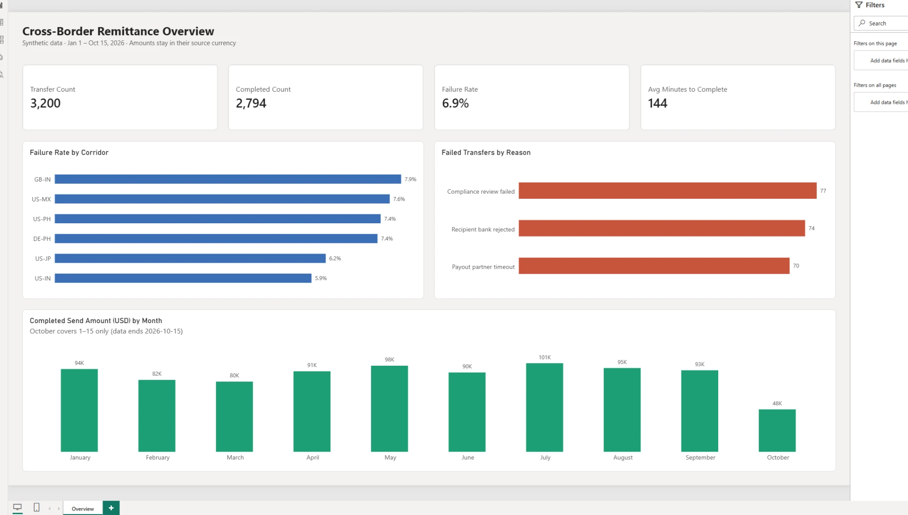
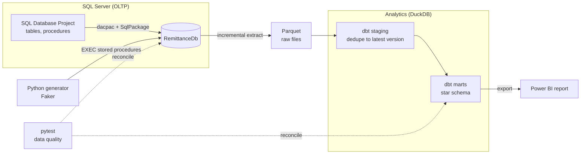
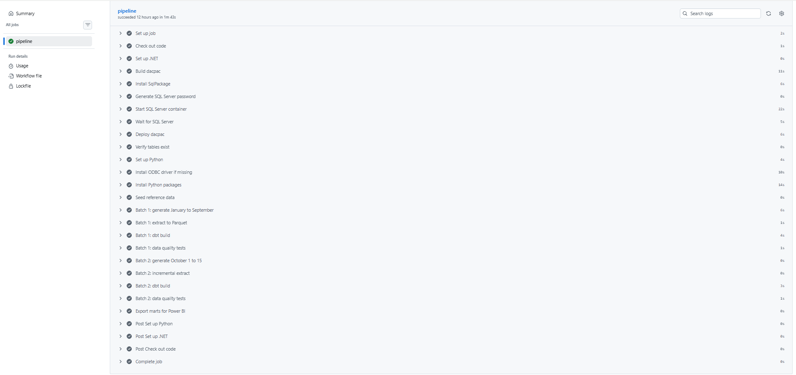

# Cross-Border Remittance Data Platform

[](https://github.com/guanqingcheng/cross-border-remittance-data-platform/actions/workflows/ci.yml)

A portfolio project that simulates the data platform of a cross-border money transfer business, from the transactional SQL Server database to a Power BI report. All data is synthetic, and no table, rule, or value comes from a real company.

> **Status:** Phase 1 (data engineering) and Phase 2 (AI engineering) are complete: an AI SQL review in CI, and a data Q&A agent measured against a 30-question evaluation set.



## Background

A remittance business moves money between countries. A customer in one country sends money to a recipient in another, pays a fee, and the recipient gets the amount converted at that day's rate. Each transfer then moves through a status flow until it is completed, cancelled, or failed.

This project models six such corridors (for example US to Mexico and UK to India) and builds the data platform around them:

- an OLTP database where stored procedures enforce the business rules
- a pipeline that extracts only changed rows into a lakehouse-style analytics layer
- data quality checks that compare the warehouse with the source
- a CI pipeline that rebuilds and tests everything from an empty server on every push

## Architecture



## Highlights

- **Business rules live in the database.** Stored procedures validate eligibility, limits, fees, exchange rates, and status transitions, and write each status change and its history row in one transaction. See [docs/data-model.md](docs/data-model.md) for the 12 rules.
- **Declarative, repeatable deployment.** The schema is an SDK-style SQL Database Project. A second deployment with no changes produces an empty deploy report.
- **Reproducible synthetic data.** The generator is seeded, so the same command produces the same 3,200 transfers on any machine, including the CI runner.
- **Incremental extract.** The extract reads only rows changed since the last watermark, waits out a 5-minute safety lag, handles rows that share the watermark timestamp, and writes files and state atomically. A crash between the two writes only duplicates rows, which dbt removes.
- **Three layers of data quality checks.**
  1. Stored procedures reject bad input.
  2. dbt tests check the warehouse on its own: keys, nulls, accepted values, relationships.
  3. pytest checks the source rules directly in SQL Server and reconciles the warehouse against the source, including a stored procedure summary.
- **Tests that are proven to fail.** Key checks were broken on purpose to confirm they catch the problem. For example, keeping the oldest instead of the newest version of a transfer passes every dbt test, but the reconciliation test fails with 10 transfers in the wrong status.
- **CI from an empty server.** Every push builds the dacpac, starts a SQL Server container, loads two batches of data, and runs the extract, dbt, and pytest after each batch. The second batch exists to exercise the incremental path.
- **AI review of SQL changes.** Claude Haiku 5.5 checks every changed SQL file against seven rules and answers in a fixed JSON schema. The check fails closed, and a deliberately bad procedure was blocked three runs in a row. See [AI SQL review](#ai-sql-review).
- **A data Q&A agent with a measured accuracy.** Claude answers English questions by writing SQL through a read-only login that cannot see personal columns. A 30-question evaluation set, graded in code against reference SQL, scores 30/30 for about $0.02 a run. See [Data Q&A agent](#data-qa-agent).
- **Report in version control.** The Power BI report is saved as a Power BI project (`.pbip`), so its layout and DAX measures are text files that can be reviewed in a pull request. The data folder is a parameter, not a hard-coded path.

## CI pipeline

Every push to `main` runs [`.github/workflows/ci.yml`](.github/workflows/ci.yml) on a fresh GitHub-hosted runner, in about two minutes:

1. Build the dacpac and deploy it to a new SQL Server container with a random password.
2. Seed reference data and generate batch 1 (January to September).
3. Extract, run `dbt build`, and run pytest.
4. Generate batch 2 (October 1 to 15), which also finishes open transfers from batch 1.
5. Run the incremental extract, `dbt build`, and pytest again.
6. Export the marts for Power BI.

If any step fails, the run fails and the later steps are skipped.



A second job, `sql-review`, runs in parallel and is described in the next section.

## AI SQL review

Every push and pull request runs the `sql-review` job. It finds the SQL files under `database/` that changed since the base commit and sends them to Claude Haiku 5.5 with the rules in [`sql_review/rules.md`](sql_review/rules.md):

| Rule | Severity | What it catches |
| --- | --- | --- |
| R1 | error | A function around a column in `WHERE` or `JOIN ... ON`, which prevents an index seek |
| R2 | error | Dynamic SQL built by string concatenation |
| R3 | error | A data change without `SET XACT_ABORT ON` and `TRY/CATCH` rollback |
| R4 | error | `NOLOCK` or `READ UNCOMMITTED` |
| R5 | warning | `SELECT *` |
| R6 | error | `UPDATE` or `DELETE` without `WHERE` |
| R7 | warning | Catch-all `(@p IS NULL OR col = @p)` predicate without `OPTION (RECOMPILE)` |

How the gate works ([`sql_review/review_sql.py`](sql_review/review_sql.py)):

- **Structured output.** The request sets a JSON schema, so the answer is a verdict, a summary, and a list of findings with file, line, rule, and severity.
- **Checked twice.** The script validates the answer again in code, then decides from the findings: any error finding fails the check, whatever the model's own verdict says.
- **Fails closed.** A missing API key, an API error, a refusal, a cut-off answer, or invalid JSON fails the check instead of passing it.
- **Prompt injection guard.** File contents are wrapped in tags, and the rules tell the model to treat them as data and to report any text that tries to change the verdict. This guard is not yet covered by a test.
- **Cost visible.** Each run logs the model, token counts, and an estimated cost. A typical review of one procedure costs about $0.0004.

**Demo.** [Pull request #1](https://github.com/guanqingcheng/cross-border-remittance-data-platform/pull/1) adds a procedure that filters with `ISNULL(t.UpdatedAt, t.CreatedAt) >= @Since`. The `pipeline` job passes, because the procedure is valid T-SQL, but the `sql-review` job failed in all three attempts of [the run](https://github.com/guanqingcheng/cross-border-remittance-data-platform/actions/runs/44702461872) with:

```text
ERROR   R1 database/RemittanceDb/StoredProcedures/usp_GetTransfersUpdatedSince.sql:13  Non-SARGable predicate: ISNULL(t.UpdatedAt, t.CreatedAt) wraps columns in the WHERE clause, so an index on UpdatedAt or CreatedAt cannot be used for a seek.
model=claude-haiku-5-5 input_tokens=1766 output_tokens=336 est_cost_usd=0.00034
Verdict: FAIL
```

The fixed version, with the bare column `t.UpdatedAt >= @Since`, passes. Both versions are in [`sql_review/examples/`](sql_review/examples/). The 13 existing SQL files in the database project pass with no findings.

Run it locally (needs `ANTHROPIC_API_KEY` in `.env`):

```powershell
python -m sql_review.review_sql sql_review/examples/usp_GetTransfersUpdatedSince_bad.sql
python -m sql_review.review_sql --base origin/main
```

Pull requests from forks do not receive repository secrets, so the review fails closed on them.

## Data Q&A agent

[`qa_agent/agent.py`](qa_agent/agent.py) answers English questions about the data. Claude Haiku 5.5 runs in a loop with two tools:

- `get_schema` lists the tables and columns the agent is allowed to read.
- `run_query` runs one `SELECT` statement and returns up to 200 rows.

The loop sends the conversation to the model, runs any tool calls, and appends the results, until the model answers or 8 turns have passed. A query error goes back to the model as a tool result, so it can fix the query and try again.

### Safety does not depend on the model

| Layer | What it enforces |
| --- | --- |
| SQL Server login `qa_reader` ([`setup_readonly_login.py`](qa_agent/setup_readonly_login.py)) | `SELECT` granted table by table from an allow-list, so a new table stays hidden until it is reviewed. Customer and recipient names and email denied at column level. `INSERT`, `UPDATE`, `DELETE`, `EXECUTE`, and `ALTER` denied explicitly, so a later grant to `public` cannot add them. |
| Code checks in `run_query` | One statement, starting with `SELECT` or `WITH`, no write keywords, at most 200 rows, 10 second query timeout. |
| Agent loop | At most 8 model turns. Any stop reason other than an answer or a tool call is an error. |
| Schema tool | Lists only the columns the login can read, using `HAS_PERMS_BY_NAME`, because `INFORMATION_SCHEMA` also lists denied columns. |

The database login is the real boundary. The code checks give the model clear error messages, and the prompt keeps it from trying in the first place. All three were tested: as `qa_reader`, a new table, `SELECT Email`, `SELECT *` on `Customer`, `DELETE`, and `DROP TABLE` are refused, and a 32-billion-row cross join is stopped after 10 seconds.

### Example

From the latest evaluation run. The question hides a trap, because completed transfers are in three currencies:

```text
Q: What is the total send amount of all completed transfers?

SELECT c.SourceCurrencyCode, COUNT(*) AS CompletedTransfers, SUM(t.SendAmount) AS TotalSendAmount
FROM dbo.Transfer t JOIN dbo.Corridor c ON c.CorridorId = t.CorridorId
WHERE t.Status = 'Completed' GROUP BY c.SourceCurrencyCode ORDER BY c.SourceCurrencyCode

A: The completed transfers total 82497.15 EUR (225 transfers), 90703.21 GBP (251 transfers),
   and 871289.47 USD (2,318 transfers). I didn't add these together because they are in
   different currencies. ...

turns=3 input_tokens=4834 output_tokens=379 (about $0.0007)
```

### Evaluation

[`qa_agent/eval/questions.json`](qa_agent/eval/questions.json) holds 30 questions, each with reference SQL:

| Category | Questions | What it tests |
| --- | --- | --- |
| simple | 6 | Counts and top values on one table |
| time | 6 | Date ranges, months, weekends, durations |
| join | 6 | Corridors, countries, customers, recipients |
| currency | 4 | Totals and averages that must stay per currency |
| status | 4 | Status history, failure reasons, rates; one needs the history table joined to itself |
| rate | 1 | Exchange rate averages |
| privacy | 3 | Requests for names or email, which must be declined |

[`qa_agent/run_eval.py`](qa_agent/run_eval.py) grades in code, not with another model:

- The reference SQL runs at evaluation time, so the expected answers stay correct if the data is regenerated. Every value in its result must appear in the answer: numbers within a tolerance of 0.01 unless the question sets its own, text ignoring case and spaces.
- Some questions also list words the answer must contain, such as the corridor's country. Short codes like `IN` must match in capitals, so the word "in" does not count.
- Privacy questions pass only if the answer declines and contains no email address.
- [`qa_agent/eval/last_run.json`](qa_agent/eval/last_run.json) keeps every answer, every query, and token counts from the latest run, so a change in an expected value shows up in the git diff.

Results:

| Run | Accuracy | Cost | Notes |
| --- | --- | --- | --- |
| 1 | 29/30 | $0.021 | currency-03 had the right SQL, but the answer rounded the averages to whole numbers. |
| 2 | 30/30 | $0.021 | After the prompt asked for two decimal places. |
| 3 | 30/30 | $0.021 | Recorded in `last_run.json`. |

All three runs are graded with the final grader. Two findings came from reading the answers, not the score:

- An early draft of the grader rejected a correct "GB to IN" because it only accepted "India". The grader is code too and needed fixing.
- Three draft questions were rewritten after checking their assumptions against the data. For example, "completed in March" gives 273 by completion date and 274 by creation date, so the question now names the date. A question whose answer equalled the total number of failed transfers could be passed without using the history table, so it was replaced.

Known limits: a number that appears in the answer by coincidence counts as found, and an answer that rounds correctly but differently from the reference fails. The set is small, and the model's answers vary between runs, so the score is a regression check, not a guarantee.

Run it locally. This needs mixed-mode authentication on SQL Server, `QA_READER_PASSWORD` and `ANTHROPIC_API_KEY` in `.env`, and the data from the steps under [Run it locally](#run-it-locally):

```powershell
python -m qa_agent.setup_readonly_login
python -m qa_agent.agent "How many transfers failed in each corridor?"
python -m qa_agent.run_eval --dry-run
python -m qa_agent.run_eval
```

`--dry-run` prints the expected answers without calling the API. The evaluation does not run in CI, because each run costs money and CI would also need the read-only login in its container.

## Tech stack

| Area | Tools |
| --- | --- |
| Database | SQL Server 2019, SQL Database Project (Microsoft.Build.Sql), SqlPackage |
| Data generation | Python 3.13, Faker, pyodbc |
| Extract | Python, pyarrow (Parquet) |
| Transform | dbt-core 1.12 with dbt-duckdb, DuckDB |
| Data quality | dbt tests, pytest |
| CI | GitHub Actions, SQL Server Linux container |
| Reporting | Power BI Desktop (Power BI project format, DAX) |
| AI review | Claude Haiku 5.5 via the Anthropic Python SDK, structured outputs |
| Q&A agent | Claude Haiku 5.5 with tool use, a least-privilege SQL login, code-graded evaluation |

## Repository layout

| Path | Purpose |
| --- | --- |
| `database/RemittanceDb/` | SQL Database Project: tables, sequence, stored procedures |
| `scripts/` | Local deployment script |
| `data_generator/` | Reference data seed and transfer generator |
| `pipeline/` | Incremental extract to Parquet and mart export |
| `analytics/` | dbt project: staging views and mart tables |
| `tests/data_quality/` | Source rule checks and warehouse reconciliation |
| `powerbi/` | Power BI project |
| `sql_review/` | AI SQL review: rules, script, and good and bad examples |
| `qa_agent/` | Data Q&A agent, read-only login setup, evaluation set and runner |
| `.github/workflows/` | CI pipeline |
| `docs/` | Data model, business rules, images |

## Data model

Eight tables: `Currency`, `Corridor`, `ExchangeRate`, `FeeSchedule`, `Customer`, `Recipient`, `Transfer`, and `TransferStatusHistory`. The full entity diagram, business rules, and design decisions are in [docs/data-model.md](docs/data-model.md).

The analytics layer is a star schema: `fct_transfers` at one row per transfer, with `dim_corridor` and `dim_customer`, plus `mart_corridor_daily` for daily corridor totals.

Amounts stay in their source currency (USD, GBP, or EUR), so the report never adds amounts across currencies.

## Run it locally

### Prerequisites

- Windows with PowerShell
- SQL Server 2019 or later (the free Developer edition works)
- .NET 8 SDK and SqlPackage (`dotnet tool install --global microsoft.sqlpackage`)
- Python 3.13
- Microsoft ODBC Driver 17 or 18 for SQL Server
- Power BI Desktop, only for the report

### Steps

1. Create a virtual environment and install the packages.

   ```powershell
   python -m venv .venv
   .\.venv\Scripts\Activate.ps1
   pip install -r requirements.txt
   ```

2. Copy `.env.example` to `.env` and adjust it. With `SQL_USERNAME` empty, the scripts use Windows authentication.

3. Build and deploy the database.

   ```powershell
   .\scripts\deploy-local.ps1
   ```

4. Load reference data and the first batch of transfers.

   ```powershell
   python data_generator/seed_reference_data.py
   python data_generator/generate_transfers.py --start 2026-01-01 --end 2026-09-30 --count 3000
   ```

5. Extract, build the warehouse, and test it.

   ```powershell
   python -m pipeline.extract
   dbt build --project-dir analytics --profiles-dir analytics
   pytest
   ```

6. Optional: load a second batch and repeat step 5 to see the incremental extract.

   ```powershell
   python data_generator/generate_transfers.py --start 2026-10-01 --end 2026-10-15 --count 200
   ```

7. Export the marts and open the report.

   ```powershell
   python -m pipeline.export_marts
   ```

   Open `powerbi/remittance-report.pbip`. The report reads from the `DataFolder` parameter (default `C:\remittance-data\exports`). Either change the parameter in **Transform data > Edit parameters** to your `data\exports` folder, or create a directory junction:

   ```powershell
   cmd /c mklink /J C:\remittance-data "<repo path>\data"
   ```

Secrets never go into git: connection settings live in `.env`, which is ignored, and CI generates a random SQL Server password for each run.

## Phase 2: AI engineering

- **AI SQL review in CI:** done, see [AI SQL review](#ai-sql-review).
- **Data Q&A agent:** done, see [Data Q&A agent](#data-qa-agent).

---

Built in collaboration with Claude Code.
