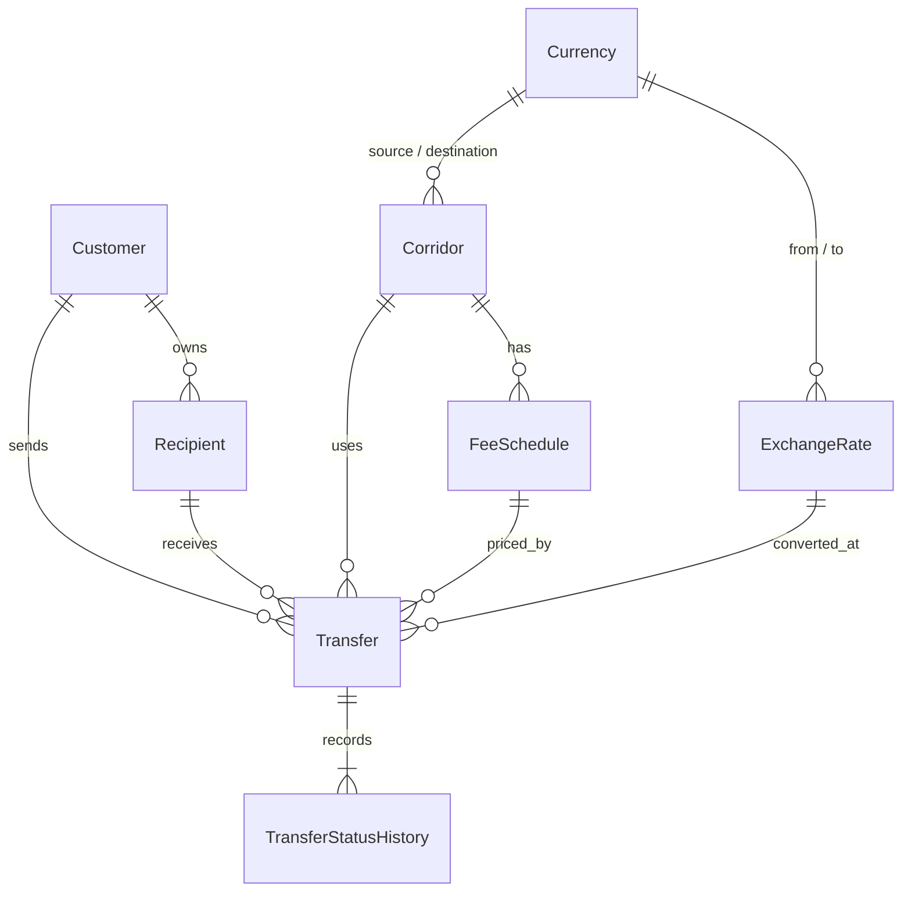

# Data Model

The source system is a simulated cross-border money transfer database, `RemittanceDb`. All customers, recipients, transfers, fees, and exchange rates are synthetic.

## Entity relationships



## Tables

All timestamps are stored in UTC.

### Currency

| Column | Type | Notes |
| --- | --- | --- |
| `CurrencyCode` | `CHAR(3)` PK | ISO 4217 code |
| `CurrencyName` | `NVARCHAR(50)` | |
| `DecimalPlaces` | `TINYINT` | 2 for USD, 0 for JPY |

### Customer

| Column | Type | Notes |
| --- | --- | --- |
| `CustomerId` | `INT IDENTITY` PK | |
| `FirstName`, `LastName` | `NVARCHAR(100)` | |
| `Email` | `VARCHAR(254)` UNIQUE | |
| `CountryCode` | `CHAR(2)` | ISO 3166-1 alpha-2 code |
| `KycStatus` | `VARCHAR(20)` | `Pending`, `Verified`, `Rejected` |
| `CreatedAt`, `UpdatedAt` | `DATETIME2(3)` | |

### Recipient

| Column | Type | Notes |
| --- | --- | --- |
| `RecipientId` | `INT IDENTITY` PK | |
| `CustomerId` | `INT` FK | Owning customer |
| `FirstName`, `LastName` | `NVARCHAR(100)` | |
| `CountryCode` | `CHAR(2)` | |
| `IsActive` | `BIT` | |
| `CreatedAt`, `UpdatedAt` | `DATETIME2(3)` | |

### Corridor

| Column | Type | Notes |
| --- | --- | --- |
| `CorridorId` | `INT IDENTITY` PK | |
| `SourceCountryCode`, `DestinationCountryCode` | `CHAR(2)` | |
| `SourceCurrencyCode`, `DestinationCurrencyCode` | `CHAR(3)` FK | |
| `MaxSendAmount` | `DECIMAL(18,2)` | Per-transfer limit |
| `IsActive` | `BIT` | |

### ExchangeRate

| Column | Type | Notes |
| --- | --- | --- |
| `ExchangeRateId` | `BIGINT IDENTITY` PK | |
| `FromCurrencyCode`, `ToCurrencyCode` | `CHAR(3)` FK | |
| `RateDate` | `DATE` | Unique with the currency pair |
| `MidRate` | `DECIMAL(18,8)` | |
| `CustomerRate` | `DECIMAL(18,8)` | Must not exceed `MidRate` |

### FeeSchedule

| Column | Type | Notes |
| --- | --- | --- |
| `FeeScheduleId` | `INT IDENTITY` PK | |
| `CorridorId` | `INT` FK | |
| `PayoutMethod` | `VARCHAR(20)` | `BankDeposit`, `CashPickup`, `MobileWallet` |
| `MinSendAmount`, `MaxSendAmount` | `DECIMAL(18,2)` | Applicable amount band |
| `FlatFee` | `DECIMAL(18,2)` | |
| `PercentFee` | `DECIMAL(6,4)` | `0.0150` means 1.5% |
| `EffectiveFrom` | `DATE` | |
| `EffectiveTo` | `DATE` NULL | `NULL` means still in effect |

### Transfer

| Column | Type | Notes |
| --- | --- | --- |
| `TransferId` | `BIGINT IDENTITY` PK | |
| `ReferenceNumber` | `VARCHAR(20)` UNIQUE | Business reference |
| `CustomerId`, `RecipientId`, `CorridorId`, `FeeScheduleId`, `ExchangeRateId` | FK | |
| `PayoutMethod` | `VARCHAR(20)` | |
| `SendAmount` | `DECIMAL(18,2)` | Source currency |
| `FeeAmount` | `DECIMAL(18,2)` | Source currency |
| `AppliedRate` | `DECIMAL(18,8)` | Snapshot of the rate used |
| `ReceiveAmount` | `DECIMAL(18,2)` | Destination currency |
| `Status` | `VARCHAR(20)` | Current status |
| `CreatedAt`, `UpdatedAt` | `DATETIME2(3)` | `UpdatedAt` is the incremental extract watermark |
| `CompletedAt` | `DATETIME2(3)` NULL | |

### TransferStatusHistory

Insert-only.

| Column | Type | Notes |
| --- | --- | --- |
| `TransferStatusHistoryId` | `BIGINT IDENTITY` PK | |
| `TransferId` | `BIGINT` FK | |
| `FromStatus` | `VARCHAR(20)` NULL | `NULL` on the first row |
| `ToStatus` | `VARCHAR(20)` | |
| `ChangedAt` | `DATETIME2(3)` | |
| `Reason` | `NVARCHAR(200)` NULL | For example, a failure reason |

## Business rules

1. **Customer eligibility:** only customers with `KycStatus = 'Verified'` can create a transfer.
2. **Amount limits:** `SendAmount` must be greater than 0 and no more than the corridor's `MaxSendAmount`. The corridor must be active.
3. **Fee:** `FeeAmount = ROUND(FlatFee + SendAmount * PercentFee, 2)`. The schedule is selected by corridor, payout method, amount band, and date. The fee is charged on top, so the customer pays `SendAmount + FeeAmount`.
4. **Exchange rate:** a transfer uses the current day's `CustomerRate`. `ReceiveAmount = ROUND(SendAmount * AppliedRate, <destination currency decimal places>)`.
5. **Status flow:** `Completed`, `Cancelled`, and `Failed` are terminal.

   ```text
   Pending -> Processing -> Completed
   Pending -> Cancelled
   Pending or Processing -> Failed
   ```

6. **Timestamps:** every status change updates `UpdatedAt`. Moving to `Completed` also sets `CompletedAt`.
7. **Recipient ownership:** the recipient must belong to the customer, be active, and be located in the corridor's destination country.
8. **Recipient corrections:** recipient names are not edited. A correction deactivates the old row and creates a new one, so historical transfers keep the original recipient.
9. **Atomic status changes:** stored procedures update `Transfer` and insert the history row in the same transaction.
10. **History consistency:** `Transfer.Status` must equal the latest `ToStatus`, and each transfer's first history row must be `NULL -> Pending`.
11. **Customer country:** the customer's country must match the corridor's source country.
12. **Ordered status changes:** a status change cannot be earlier than the transfer's last update, which keeps the incremental extract watermark reliable.

## Stored procedures

| Procedure | Purpose |
| --- | --- |
| `usp_CreateTransfer` | Validates rules 1-4, 7, and 11, calculates amounts, creates the transfer and its first history row |
| `usp_UpdateTransferStatus` | Validates rules 5 and 12, updates the transfer, inserts a history row |
| `usp_GetCustomerTransferHistory` | Returns one customer's transfers, optionally filtered by date |
| `usp_GetDailyCorridorSummary` | Summarizes counts for all transfers and amounts for completed transfers, by date and corridor |

`usp_CreateTransfer` takes an optional `@AsOfUtc`, and `usp_UpdateTransferStatus` takes an optional `@ChangedAtUtc`. Both default to the current time. They exist so the data generator can create historical data through the same validation as normal transfers. A production system would use server time only.

Reference numbers such as `RM0000000001` come from the `TransferReferenceSequence` sequence, so seeded data can be reproduced.

## Design decisions

- **`DECIMAL` for money:** `FLOAT` is approximate and can cause reconciliation differences.
- **Amount and rate snapshots on `Transfer`:** later changes to rates or fee schedules must not alter historical transfers.
- **UTC timestamps:** the business spans several time zones.
- **Composite foreign key for recipient ownership:** `Transfer (RecipientId, CustomerId)` references `Recipient (RecipientId, CustomerId)`, so the database rejects a transfer that uses another customer's recipient, even if a stored procedure is bypassed.
- **Procedure-enforced rules:** other cross-table rules cannot be expressed as `CHECK` constraints, so stored procedures enforce them and data quality tests verify them.

## Synthetic reference data

- **Currencies:** USD, EUR, GBP, MXN, PHP, INR, JPY
- **Corridors:** US to MX, US to PH, US to IN, US to JP, GB to IN, DE to PH
